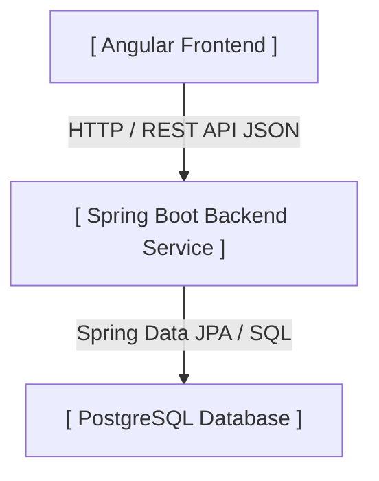

 

# OffLoader 📝

 

**OffLoader** is a full-stack note-taking and task-tracking web application. It is designed to help users offload mental clutter by capturing freeform thoughts, structured checklists, and daily tasks in one seamless workspace.

---

## 🚀 Tech Stack

### Frontend
- **Framework:** Angular &nbsp; 
- **Styling:** CSS / SCSS &nbsp;  
- **State & HTTP:** Angular Services & HttpClient &nbsp; 

### Backend
- **Language:** Java &nbsp; 
- **Framework:** Spring Boot &nbsp; 
- **API Architecture:** RESTful APIs &nbsp; 
- **ORM:** Spring Data JPA (Hibernate) &nbsp; 

### Database
- **Database Management System:** PostgreSQL &nbsp; 

---

## 🏗 System Architecture

OffLoader follows a standard three-tier architecture:

---

## 📌 Core Features (In Development)

- [ ] **Dual-Type Notes:** Support for both rich text notes and interactive checklist items.
- [ ] **Dynamic Checklist Management:** Real-time checking, unchecking, and ordering of todo items.
- [ ] **Labeling & Tagging:** Organize notes using custom labels and many-to-many tag relationships.
- [ ] **Color Coding & Organization:** Customize note card colors and pin priority notes to the top.
- [ ] **Archive & Trash Management:** Archive completed tasks or move items to trash with soft-delete capabilities.

---

## 🎯 Future Goals

- [ ] **User Authentication & Accounts:** Implement secure multi-user sign-up, login, and JWT-based session management.
- [ ] **Cloud Synchronization:** Sync notes and checklists seamlessly to PostgreSQL, accessible from any browser.
- [ ] **Dedicated Android App:** Build a mobile companion app with full web feature parity plus smartphone-specific capabilities (e.g., widgets, offline sync, push notifications).
